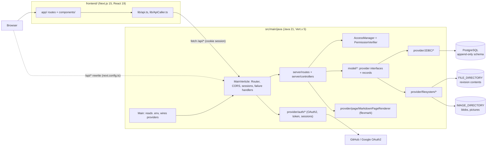

# Architecture

hikkei is two applications in one repository: a Java backend serving a JSON API under
`/api/*`, and a Next.js frontend that renders the wiki and calls that API. The backend
keeps metadata in PostgreSQL and revision contents and uploaded files on the filesystem.

## Backend (`src/main/java/dev/tfkls/hikkei`)

- **`Main`** reads configuration from `.env` (dotenv-java; see README "Setup"), opens one
  JDBC connection, builds every provider, ensures the `admin` super user exists, registers the
  auth methods that are configured (admin token, GitHub, Google) and deploys `MainVerticle`.
- **`server/MainVerticle`** builds the Vert.x `Router`: failure handlers, the session cookie
  handler, request logging, CORS for `FRONTEND_URI`, the body handler, then one sub-router per
  resource (`auth`, `user`, `page`, `revision`, `comment`, `category`, `blob`).
- **`server/routes/*RouteHandler`** map the endpoints listed in the README to
  **`server/controllers/*Controller`** methods, registered as Vert.x `blockingHandler`s (JDBC
  is blocking). Controllers check permissions through the `AccessManager`, call the providers
  and serialise records with `server/util/Jsonify`; `ParamFlow` and `Type` parse and validate
  request parameters.
- **`model/*`** holds the domain as Java records (`UserData`, `PageData`, `RevisionData`, ...)
  and provider interfaces (`UserDataProvider`, `VersionProvider`, `PageRenderer`, ...). Route
  handlers depend only on these interfaces ([ADR 0002](decisions/0002-provider-interfaces.md)).
- **`provider/*`** implements them:
  - `JDBC/*` for PostgreSQL ([ADR 0003](decisions/0003-append-only-postgresql-schema.md));
  - `filesystem/*` stores revision contents and blobs as UUID-named files
    ([ADR 0004](decisions/0004-content-on-filesystem-markdown-rendering.md));
  - `page/MarkdownPageRenderer` renders Markdown with flexmark (wiki links, strikethrough);
  - `auth/*` implements OAuth2 sign-in (Vert.x OAuth2), the admin token, in-memory sessions
    and the auth event handler ([ADR 0005](decisions/0005-oauth2-sessions-and-permission-ladder.md));
  - `permission/*` computes the effective permission level; `Dummy*` variants disable auth.
- **`util/*`**: `BoundedMap`, `ClockView`, `ThrowingConsumer`.

### Database (`src/main/resources/dev/tfkls/hikkei/database`)

`create.sql` includes `schema.sql`, `views.sql`, `rules.sql` and `triggers.sql`; `drop.sql`
removes everything. Entities (`users`, `categories`, `pages`, `revisions`, `comments`,
`drafts`, `blobs`, `auth`) keep their changing attributes in dated history tables
(`user_name`, `page_title`, `revision_approved`, ...). Rules turn `UPDATE` and `DELETE` into
no-ops on the history tables, deletion is a `deleted` flag with `date_deleted`, and the
`*_with_data` views expose the latest value of each attribute; triggers make inserts through
those views write the history rows and enforce unique usernames and titles.

### Request flow

1. The browser calls `/api/...` with the `HikkeiSession` cookie (`credentials: "include"`).
2. `SessionHandler` resolves the cookie to a user id through the `SessionProvider`.
3. The controller loads the target object, sets the category in the routing context and
   asks the `AccessManager` to verify the level the action needs (401 for an anonymous user,
   403 for a signed-in user whose level is too low).
4. Providers read or write PostgreSQL and the filesystem; the controller answers JSON.
5. Failures map to HTTP codes in `FailureHandler`: an `HttpException` keeps its status
   (400/401/403/404 from controllers and permission checks), `BadDataException` 400,
   `InternalErrorException` and anything else 500; auth failures redirect to
   `AUTH_FRONTEND_REDIRECT` + `/failure` (default `/auth/failure`).

## Frontend (`frontend/`)

Next.js App Router application (`src/app`): landing page, `articles/[slug]` (article,
comments, revisions), `articles/new`, `revision/new` (editor with preview), `categories`,
`account`, `auth` and `register`. Components live in `src/components/<Area>`, styles in CSS
modules, the API client in `src/lib` (`apiClient` redirects to `/auth` on 401 and
`/forbidden` on 403). `NEXT_PUBLIC_API_BASE` (in `.env.local`) is the backend's base URL;
`next.config.ts` also rewrites `/api/*` to it and loads SVGs through `@svgr/webpack`.

## Tests

`src/test/java` mirrors the main packages: Mockito unit tests (`*MockTest`, `*Test`),
JDBC integration tests (`*IntegrationTest`, including `nullability/` and `internal/` error
paths) and HTTP route integration tests that start the verticle and call it with
REST Assured. Integration tests read the database settings from the environment or
`.test-env` and are skipped when they are missing; `scripts/ci/backend.sh` provides a
disposable PostgreSQL so they always run in CI ([ADR 0006](decisions/0006-testing-and-style-conventions.md)).

## Build and CI

Gradle (wrapper 8.5) builds the backend: spotless (google-java-format), compile, tests,
JaCoCo report, PMD unused-code rules and the dependency-analysis `buildHealth`. npm builds the
frontend. Yulius CI runs `scripts/ci/{scripts,backend,frontend}.sh` as separate jobs on our
own machines ([ADR 0007](decisions/0007-yulius-ci-and-ratcheted-gate.md)). Nothing is deployed
automatically yet: `[cd.dev]` and `[cd.prod]` in `yulius.toml` are empty.
